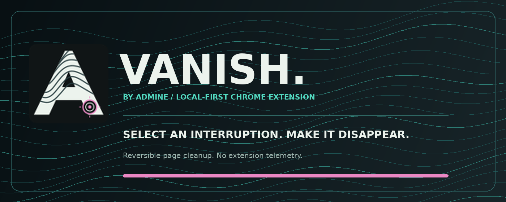
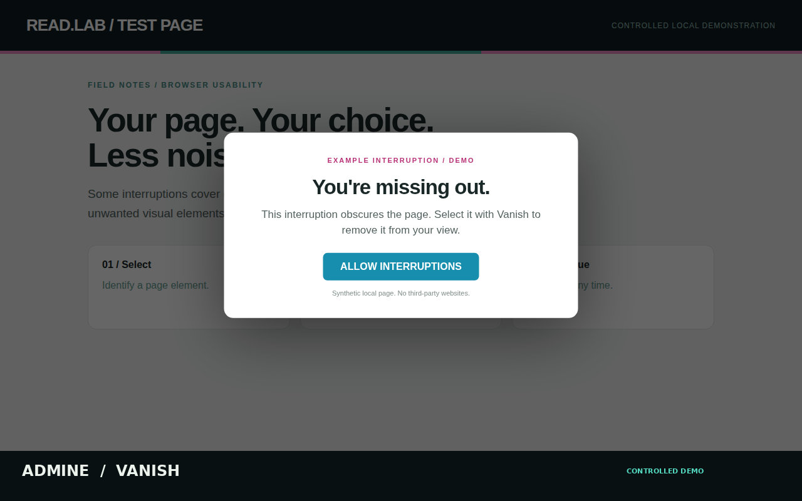
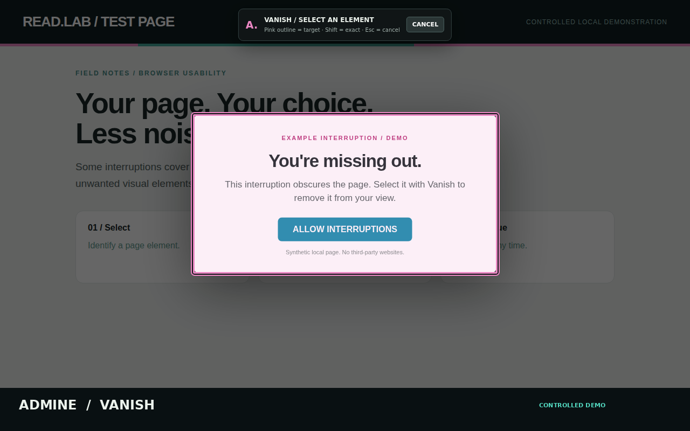
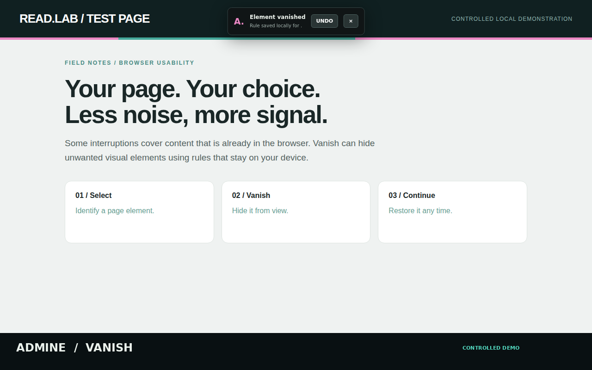
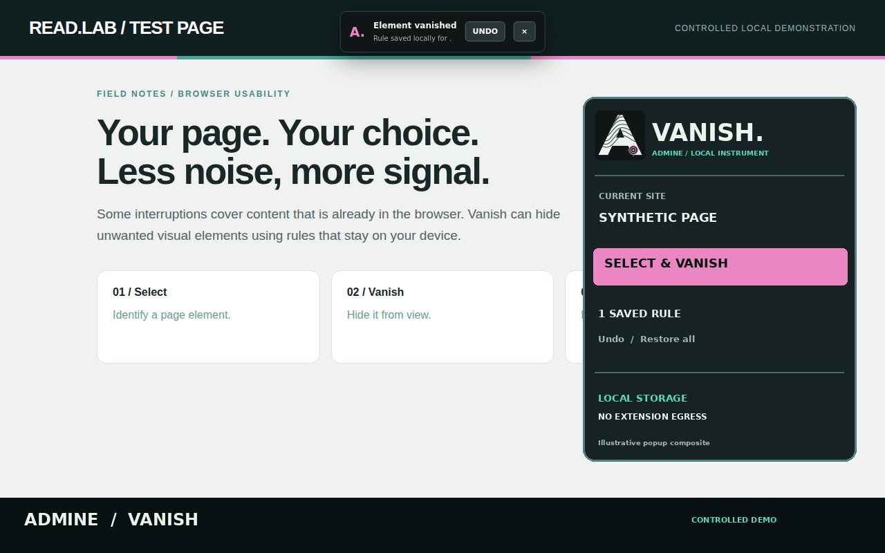

**Make the interruption disappear. Keep the page.**

A lightweight Chrome extension for selecting and hiding unwanted page elements.

[**Try the interactive ADMINE demo**](https://admine.au/projects/vanish/#v-demo) · [Install](#install) · [Screenshots](#see-vanish-in-action) · [Privacy](#privacy) · [Licence](#licence)

---

## The idea

Some sites put banners, floating boxes, newsletter prompts and overlays in front of what you're trying to read. Vanish gives you a simple way to remove the *visual obstruction* without digging through developer tools.

**Click Vanish → choose an element → continue browsing.** Vanish remembers your selection for that website. If you change your mind, undo it.

> Vanish changes what is displayed in your browser. It does not unlock subscriptions, bypass sign-in, defeat server-side access controls or retrieve content a site hasn't sent.

## What it does

| | Capability |
|:--|:--|
| **Select** | Point at an element to preview exactly what will be hidden. |
| **Vanish** | Hide the selected element, and try to remove a related backdrop. |
| **Continue** | Recover scrolling when an overlay has locked the page, where possible. |
| **Remember** | Keep simple, reversible rules for websites you explicitly approve. |
| **Restore** | Undo one selection, restore an entire site, pause rules, or clear everything. |
| **Choose your theme** | Light, dark or match your system. |

## See Vanish in action

Screenshots of the selection workflow from the project's **controlled local Chromium demonstration**. No real news site, user data, or private browsing information is involved. Want to click through it instead? [Open the interactive demo on ADMINE](https://admine.au/projects/vanish/#v-demo).

| 01 / Before — page obscured | 02 / Select — preview the target |
| :--- | :--- |
|  |  |

| 03 / After — interruption hidden | 04 / Local rules — illustrative interface |
| :--- | :--- |
|  |  |

The fourth image is an **illustrative composite**, not a screenshot of a live extension popup. The first three are captured from the browser-based demonstration. The [ADMINE project page](https://admine.au/projects/vanish/) includes the interactive version, which you can reset and replay.

## Install

Vanish is provided as inspectable source and a tested Chrome extension package.

1. Open the [latest security-validated build](https://github.com/0xdx-au/vanish/actions/workflows/verify.yml). Under **Artifacts**, download the versioned extension archive from a successful workflow run.
2. Unzip the archive into a folder you control.
3. Open `chrome://extensions` in Chrome, switch on **Developer mode**, and choose **Load unpacked**.
4. Select the extracted folder containing `manifest.json`.
5. Pin **Vanish** to the toolbar, then visit an ordinary website to try it.

You can also clone the repository and load its root folder directly. The project does not require a backend account or a build step.

## How it works

**01 / Open Vanish** — On the page you want to tidy, click the extension icon and select **Select & Vanish**.

**02 / Approve the site** — Chrome asks for permission before Vanish works on a new site. Approval is optional; nothing is hidden if you decline.

**03 / Select** — Move your pointer over the unwanted element. Vanish highlights your selection before you click.

**04 / Done** — Click to hide it. The choice is remembered locally for that website. Use **Restore** if you want it back.

### Controls

| Action | Result |
|:--|:--|
| Click an outlined element | Hide it and save a rule |
| Hold **Shift** while selecting | Select the precise element beneath the pointer |
| Press **Esc** | Cancel without saving |
| **Undo last** | Restore the most recent saved selection |
| **Restore origin** | Clear saved selections for the current site origin |
| **Enabled** switch | Temporarily pause or resume saved rules |
| **Forget hostname** | Clear that hostname's rules and revoke its site permissions |
| **Purge all sites** | Clear every Vanish rule and site approval |

Refreshing an already-open tab may be required after permissions are revoked.

## Privacy

**Your choices stay on your device.** Vanish does not have an account, analytics service or remote rules server. It doesn't send selected page content to ADMINE, and does not save text copied from the elements you hide.

Rules are stored locally in Chrome and can be removed at any time. Chrome and the websites you visit still make their own network connections; Vanish does not control that traffic.

- Site access is requested when you choose to use Vanish.
- Your saved choices are private to your local Chrome profile, not encrypted against someone who already controls that profile.
- **Incognito mode is not supported.**
- Removing an overlay cannot guarantee that a website will continue working.

For implementation details, audits, test coverage and known limitations, see [Security](SECURITY.md) and the [privacy and threat model](docs/PRIVACY-AND-THREAT-MODEL.md). Technical documentation is available without filling the main interface with engineering details.

## Compatibility and limits

Vanish works with ordinary HTTP and HTTPS pages in Chrome. Built-in browser pages and the Chrome Web Store do not allow extensions to interact with their contents. Some embedded frames, unusual page structures, rapidly changing interfaces or website-specific scroll controls may resist visual cleanup.

When Vanish cannot safely identify an element, it should decline the selection rather than pretend it worked.

**Upgrading from v1.2?** Vanish v1.3 deliberately clears the previous version's saved selections and site permissions. Reapprove sites as needed and reload tabs that were already open. Do not reuse the outdated v1.2 extension package.

## Build quality

The repository includes tests for permissions, local data handling, page-element selection, restoration and browser behaviour. GitHub Actions runs both source checks and real, unpacked Chromium tests before producing a release candidate.

[View verification runs](https://github.com/0xdx-au/vanish/actions/workflows/verify.yml) · [Review the source](https://github.com/0xdx-au/vanish)

No browser extension can promise compatibility with every website or absolute security. These tests provide repeatable evidence for the version being tested.

## Licence

**PolyForm Noncommercial 1.0.0.** Vanish is **source-available for non-commercial use**. You may inspect, use, modify and share it for purposes permitted by that licence, retaining required notices. **Commercial use is not granted**, including third-party sale or use for commercial purposes without a separate agreement. The copyright holder may offer commercial licences or sell Vanish independently.

Public GitHub source does not, by itself, make software OSI open source. PolyForm Noncommercial is **not an OSI-approved open-source licence**, because it restricts commercial use.

See [LICENSE](LICENSE), [NOTICE](NOTICE), and [trademark guidance](TRADEMARKS.md). The ADMINE and Vanish names and visual marks are not an endorsement of third-party builds.

---

**ADMINE**

Less noise. More signal.

[Project page](https://admine.au/projects/vanish/) · [Security](SECURITY.md) · [Licence](LICENSE)

